# 🤖 Awesome AI Agent Directories

  

  
  
  
  
  
  

---

## 🧭 Curated AI Agent Directories & Ecosystem Overview

> **A comprehensive, SEO-optimized curated index of premier AI agent directories, SaaS discovery engines, autonomous agent catalogs, multi-agent framework indexes, and runnable open-source implementation repositories.**

📅 **Last updated:** October 2026

This repository tracks the leading **SaaS directories** and **open-source catalogs** for **AI Agent Directories**. Whether you are discovering ready-to-use commercial agents, evaluating multi-agent orchestration frameworks, or cloning production-grade open-source agent blueprints, this directory indexes the best resources available across web, desktop, and cloud environments.

---

## 📑 Table of Contents
- [📊 Sector Overview & Market Dynamics](#-sector-overview--market-dynamics)
- [🌐 SaaS / Hosted Platforms](#-saashosted-platforms)
- [💻 Open-Source GitHub Projects](#-open-source-github-projects)
- [🤝 How to Contribute](#-how-to-contribute)
- [💖 Support & Sponsorship](#-support--sponsorship)
- [📈 Star History](#-star-history)
- [⚖️ Disclaimer](#-disclaimer)

---

## 📊 Sector Overview & Market Dynamics

The AI agent directories and discovery market is an integral sub-segment of the broader AI software discovery landscape, currently estimated at **$1.8B to $2.5B in 2026** and projected to surpass **$7B+ by 2030** as autonomous agent ecosystems accelerate. 

The sector is **moderately to highly fragmented** at the long tail with hundreds of niche directories and hobbyist scrapers, but exhibits strong **winner-take-most dynamics** at the top tier. Market leadership is driven predominantly by SEO authority, organic search monopolies, large-scale email newsletters (e.g., There's An AI For That and Futurepedia), and deep community moats in open source (e.g., AutoGPT and LangGraph). Strategic acquisitions by marketing platforms (such as HubSpot acquiring Futurepedia) underscore the increasing concentration of high-intent developer and enterprise discovery traffic among category leaders.

---

## 🌐 SaaS / Hosted Platforms

| 🏢 Platform | 💰 Company Size (Valuation / Revenue) | 🏷️ Pricing (Starting Tier) | 🎁 Free Tier Limit | 📝 Description |
| :--- | :--- | :--- | :--- | :--- |
| **[Futurepedia](https://www.futurepedia.io/)** | **~$11.2B Market Cap** *(Acquired by HubSpot)* | $497 one-time (Verified listing) / $24.99/mo (Skill Leap courses) | Free unlimited directory browsing and search; tool submission has 0-day free trial (paid verified listing required for guaranteed review) | Curated AI tools directory with filters by use case, pricing, and features; frequently updated with new AI applications and agents. |
| **[Toolify.ai](https://www.toolify.ai/)** | **~$2.34M ARR** / $500K Seed raised | $99 one-time (Expedited permanent review & backlink) / $29 one-time (GPT listing) | Free forever standard tool submission with queue-based manual review; free unlimited directory browsing and ranking inspection | AI tools ranking and directory platform that aggregates and ranks AI products and agent-style applications. |
| **[There's An AI For That](https://theresanaiforthat.com/)** | **~$1.5M - $2M ARR est.** *(4M+ monthly visits, 1.7M+ newsletter subs)* | $49 one-time (Standard listing) | Free forever search and task-based discovery across 50,000+ AI tools; tool submission review queue has no free trial | Large searchable directory of AI tools and agents organized by task and category, popular for quick discovery of new AI products. |
| **[FutureTools](https://www.futuretools.io/)** | **~$500K - $1M ARR est.** *(250K+ newsletter subs, Matt Wolfe / Media)* | $197/week (Featured top directory sponsorship) | Free forever tool submission (human-curated review queue, no guaranteed listing time); free unlimited directory exploration and news access | AI tools and agents directory focused on emerging products, with rankings and categorization for builders and users. |
| **[TopAI.tools](https://topai.tools/)** | **~$300K - $600K ARR est.** *(Bootstrapped, ~1M monthly visits)* | $47 one-time (Standard review within 24-48h) | Free forever directory search and AI categorization; 0-day free trial for tool submissions (all submissions require paid review fee) | Curated list and search engine for AI tools and agents with categorization and user-oriented discovery features. |
| **[Insidr.ai](https://www.insidr.ai/)** | **~$200K - $500K ARR est.** *(Insidr AI ApS, affiliate/consulting model)* | $99 one-time (Fast-track review & featured badge) | Free forever submission plan provided creator includes an active affiliate link; free unlimited access to prompts and tool guides | AI tools and agents directory aimed at professionals seeking practical AI solutions and productivity agents. |
| **[Dang.ai](https://dang.ai/)** | **~$150K - $300K ARR est.** *(Bootstrapped micro-SaaS)* | $29 one-time (Fast-track standard listing without badge) | Free forever listing option for 1 category with active mandatory backlink/badge on submitter site (up to 4-week review); free browsing | AI tools directory focused on discovery and comparison of AI products and agent capabilities. |
| **[Easy With AI](https://easywithai.com/)** | **~$100K - $250K ARR est.** *(Bootstrapped directory)* | $125 one-time (Permanent directory placement, 24h review) | Free forever directory search, prompt guides, and tool comparisons; 0-day free trial for submissions (paid placement only) | Accessible directory of AI tools and agents organized for ease of use and quick adoption. |
| **[AI Valley](https://aivalley.ai/)** | **~$50K - $150K ARR est.** *(Bootstrapped community directory)* | $20/week (Sponsored homepage banner / featured slot) | Free forever tool submission form with manual editorial review queue; free forever platform access to tools and prompts | Directory and community-oriented listing of AI tools, agents, and platforms. |
| **[AI Cyclopedia](https://aicyclopedia.com/)** | **<$100K ARR est.** *(Independent niche project)* | $29 one-time (Fast-track verification tier) | Free forever standard tool submission form and free knowledge base browsing across categories | Directory and knowledge base covering AI tools, agents, and related resources across multiple domains. |

---

## 💻 Open-Source GitHub Projects

Sorted in descending order by GitHub stars. Each repository includes a real-time star badge linking to its official stargazers page:

1. **[AutoGPT](https://github.com/Significant-Gravitas/AutoGPT)**   
   The pioneer open-source autonomous agent ecosystem with extensive community extensions, agent builder environments, and runnable multi-agent patterns.

2. **[browser-use](https://github.com/browser-use/browser-use)**   
   The leading open-source web browsing and computer-use agent library that makes websites accessible for AI agents with interactive automation workflows.

3. **[OpenHands](https://github.com/All-Hands-AI/OpenHands)**   
   Formerly OpenDevin, a platform for software development AI agents capable of writing code, running bash commands, and collaborating on complex codebases.

4. **[AutoGen](https://github.com/microsoft/autogen)**   
   Microsoft's premier open-source multi-agent conversation framework and extensive showcase directory for orchestrating collaborative AI agent workflows.

5. **[CrewAI](https://github.com/crewAIInc/crewAI)**   
   Cutting-edge framework for orchestrating role-playing autonomous AI agents, accompanied by extensive showcases, template repositories, and production crew directories.

6. **[LlamaIndex](https://github.com/run-llama/llama_index)**   
   Data framework for LLM applications with dedicated agent orchestration, LlamaHub tool catalog, and retrieval-augmented agent directories.

7. **[LangGraph / LangChain Agents](https://github.com/langchain-ai/langgraph)**   
   Official and community agent repository that functions as a living index of cyclical graph workflows, multi-agent state machines, and resilient architectures.

8. **[500-AI-Agents-Projects](https://github.com/ashishpatel26/500-AI-Agents-Projects)**   
   Massive catalog of 500+ practical AI agent implementations categorized by vertical, industry, and orchestration framework with runnable tutorials and source code.

9. **[awesome-ai-agents](https://github.com/e2b-dev/awesome-ai-agents)**   
   Comprehensive, community-curated list of autonomous AI agents, developer frameworks, execution sandboxes, and foundational agent papers.

---

## 🛠️ Frameworks & Discovery Strategy

* **Explore & Identify**: Use SaaS directories like **There's An AI For That**, **Futurepedia**, and **Toolify.ai** to inspect trending use cases and validated consumer/B2B products.
* **Clone & Blueprint**: Browse open-source catalogs like **500-AI-Agents-Projects** and **awesome-ai-agents** to find tested reference architectures.
* **Orchestrate & Deploy**: Implement resilient multi-agent patterns using production engines like **AutoGPT**, **CrewAI**, **AutoGen**, and **LangGraph**.

---

## 🤝 How to Contribute

Contributions are warmly welcomed! Help keep this directory current, accurate, and comprehensive:

1. 🍴 **Fork the repo** to your personal GitHub account.
2. 🌿 **Create a branch** for your feature or catalog update (`git checkout -b add-new-agent-directory`).
3. ✍️ **Add or edit entries** in `README.md` following the established format:
   - Include: Name, official URL, concise factual description, and star badge / pricing data.
4. 🚀 **Submit a Pull Request** with a clear explanation of why the addition is valuable to the community.

Please check existing listings before opening a PR to avoid duplicates!

---

## 💖 Support & Sponsorship

If you find **Awesome AI Agent Directories** helpful for discovering tools, benchmarking frameworks, or building autonomous agents, please consider supporting the project!

- ⭐ **Star this repository** to help others discover it.
- 🍴 **Fork and share** with your network, engineering teams, and AI communities.
- ☕ **Buy me a coffee / Sponsor the project**: Support ongoing maintenance, verification, and curation on GitHub Sponsors:  
  👉 **[Sponsor on GitHub Sponsors (ishandutta2007)](https://github.com/sponsors/ishandutta2007)**

Thank you for being part of the open AI agent community! 🙏

---

## 📈 Star History

---

## ⚖️ Disclaimer

- This is an independently maintained, **community-curated index** — listings are not formal endorsements or financial advice.
- AI products, pricing structures, and open-source licenses evolve rapidly; always verify terms of service, security postures, and code licenses directly with providers before production adoption.

---

  <b>Built with ❤️ for the global AI developer, researcher, and open-agent builder community.</b>

